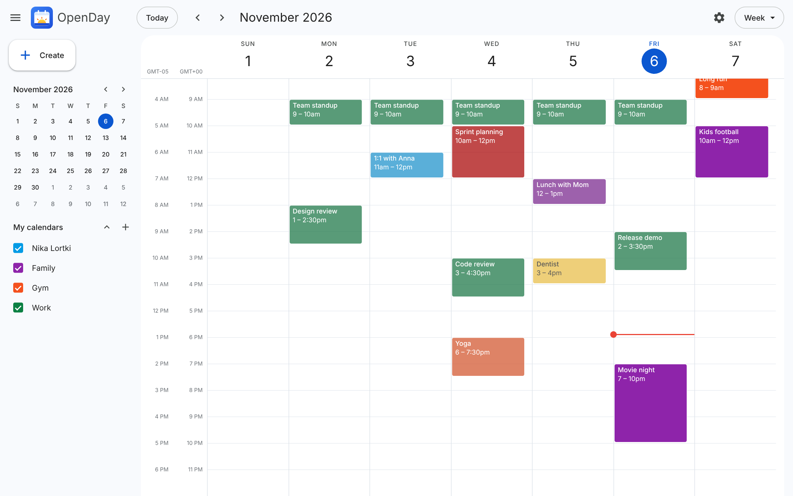
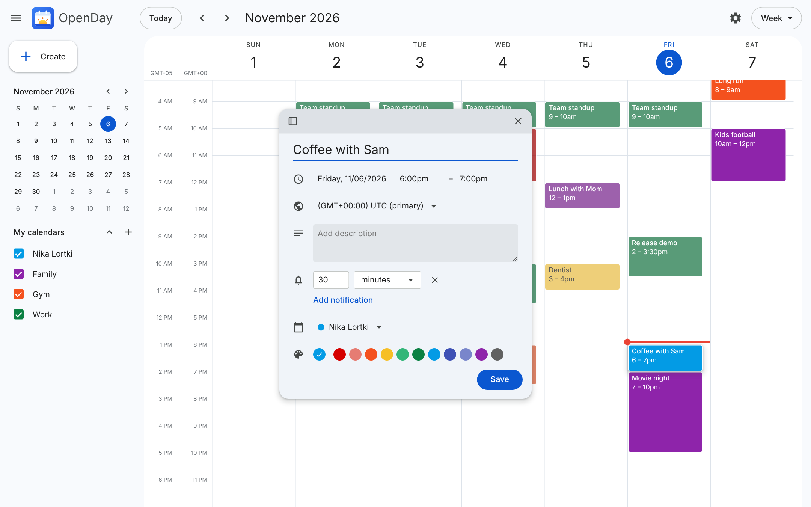
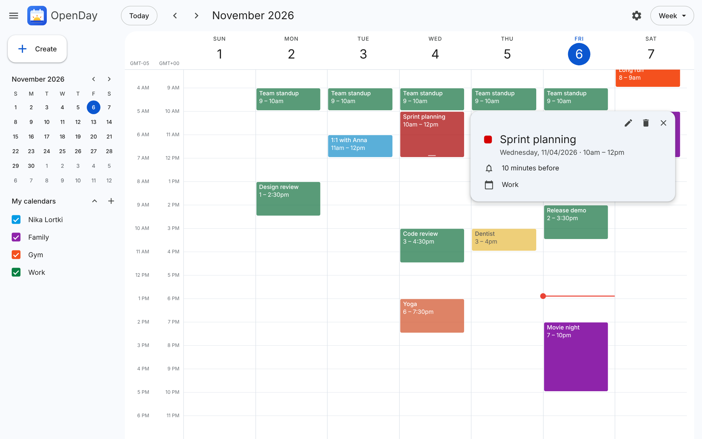
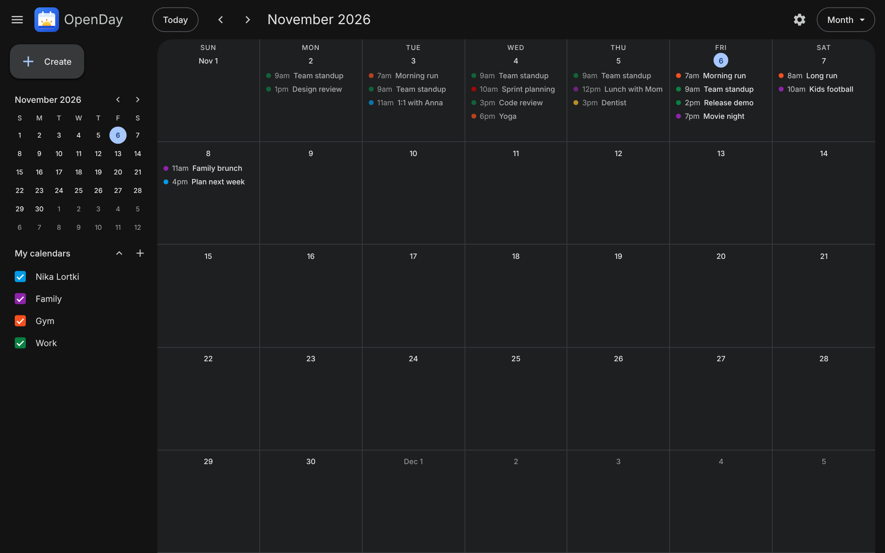
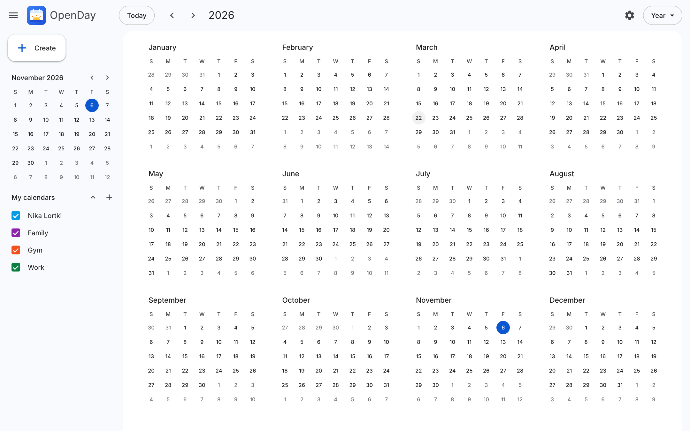
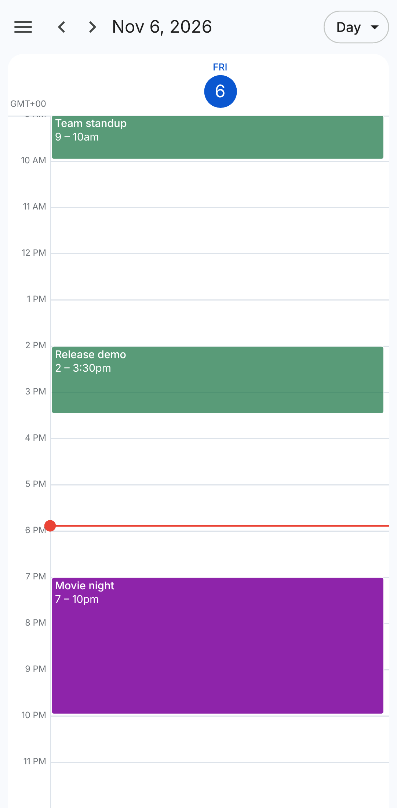

<p align="center">
  
</p>

<h1 align="center">OpenDay</h1>

<p align="center">
  <b>A self-hosted calendar that looks and works like Google Calendar.</b><br>
  Open source. One Docker container. Your data, on your server.
</p>

<p align="center">
  <a href="LICENSE"></a>
  
  
  
  
</p>

<p align="center">
  <a href="#-quick-start">Quick start</a> ·
  <a href="#-features">Features</a> ·
  <a href="#-screenshots">Screenshots</a> ·
  <a href="#-for-developers">For developers</a>
</p>

<p align="center">
  
</p>

> [!WARNING]
> OpenDay is in early development. Many features are missing and things may change or break between updates.

## 📸 Screenshots

<table>
  <tr>
    <td width="50%"><br><p align="center"><b>Create events</b> — time, time zone, notifications, calendar, color</p></td>
    <td width="50%"><br><p align="center"><b>Event details</b> — edit or delete in one click</p></td>
  </tr>
  <tr>
    <td width="50%"><br><p align="center"><b>Month view</b> — with dark theme</p></td>
    <td width="50%"><br><p align="center"><b>Year view</b> — the whole year at a glance</p></td>
  </tr>
</table>

<p align="center">
  <br>
  <b>Works on phones</b> — tap, long-press, swipe
</p>


## 🚀 Quick start

You need [Docker](https://docs.docker.com/get-docker/).

```bash
git clone https://github.com/lortkipa/openday.git
cd openday
docker build -t openday .
docker run -d --name openday -p 8080:8080 -v openday-data:/data --restart unless-stopped openday
```

Open **http://localhost:8080**.

Your events are saved in the `openday-data` volume.

## 🧰 Commands

| What | Command |
| --- | --- |
| Stop | `docker stop openday` |
| Start again | `docker start openday` |
| See logs | `docker logs openday` |
| Delete the app (keeps your data) | `docker rm -f openday` |
| Delete your data too | `docker volume rm openday-data` |

## 🔄 Update

```bash
git pull
docker build -t openday .
docker rm -f openday
docker run -d --name openday -p 8080:8080 -v openday-data:/data --restart unless-stopped openday
```

Your data stays in the volume.

## ✨ Features

- Day, week, month and year views.
- Click the calendar to add an event. Drag to pick a time range.
- Drag events to move them. Drag the bottom edge to resize.
- Events have a title, description and color. Events can overlap.
- Right-click an event to change its color or delete it.
- Several calendars (for example "Work" and "Family"), each with its own name and color. Tick them in the sidebar to show or hide their events. Create, rename, recolor and delete calendars in Settings.
- The event form can float or be docked to the side. On phones it slides up from the bottom.
- Notifications: each event can have up to 5 reminders ("30 minutes before"). Set any number of minutes, hours, days or weeks (up to 4 weeks). Shown as desktop notifications (with Snooze) or as alerts in the page, with an optional sound. The calendar must be open in a browser tab.
- Settings: date format, time format, time zone, default event length, default notification, notification settings.
- Several time zones: add up to 5 other time zones in Settings. They show as extra hour columns in the day and week views, and you can set an event's time zone to any of them.
- Light, dark or device theme.
- Works on phones: tap to add or open, hold an event to drag it or open its menu, swipe to change the day/week/month.
- Keyboard shortcuts: `D` `W` `M` `Y` (views), `T` (today), `J`/`K` (next/previous), `C` (create).

## 🛠️ For developers

Run the backend (Go) and the frontend (Vite) in two terminals:

```bash
cd backend && go run .
```

```bash
cd frontend && npm install && npm run dev
```

Open http://localhost:5173. Run the backend tests with `cd backend && go test ./...`.

AI coding agents should read [`AGENTS.md`](AGENTS.md) first.

## 📄 License

[MIT](LICENSE)
